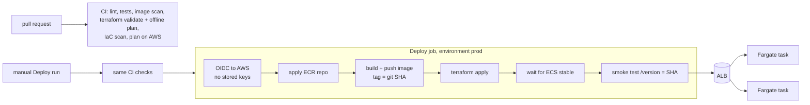

# AWS CI/CD Showcase: GitHub Actions, OIDC, Terraform, ECR, ECS Fargate

A small containerized API deployed to **AWS** with a pipeline that holds no AWS keys: GitHub Actions authenticates with short-lived OIDC credentials, Terraform builds the infrastructure, and the same pipeline builds, pushes and verifies the container on **ECS Fargate behind an Application Load Balancer**.

> **Status: validated, not yet deployed.** I built this without an AWS account to run it against. Everything that can be checked without one *is* checked on every push (see [What is verified](#what-is-verified-and-what-is-not)), but the Deploy workflow has never run against real AWS. Run [`scripts/bootstrap.sh`](scripts/bootstrap.sh) in a sandbox account to get the first real deploy.



## What gets built (28 Terraform resources)

| Piece | Details |
|---|---|
| **Network** | VPC, two public subnets in two AZs, internet gateway, routes. Tasks accept traffic **only from the load balancer's security group**. |
| **ECR** | Immutable tags (a SHA always means the same image), scan on push, lifecycle policy keeps the last 10 images. |
| **ALB** | Internet-facing, target group on `/health`, `drop_invalid_header_fields` on. |
| **ECS Fargate** | 2 tasks (0.25 vCPU / 0.5 GB), read-only root filesystem, non-root user, container health check, logs to CloudWatch (14-day retention). |
| **Safe rollouts** | `minimum_healthy_percent = 100` and the ECS **deployment circuit breaker with rollback**: a release whose tasks never become healthy is rolled back automatically. |
| **Autoscaling** | Target tracking on CPU (60%), 2 to 4 tasks. |
| **Monitoring** | CloudWatch alarm on unhealthy targets; optional SNS email if `alert_email` is set. |
| **IAM** | Separate task *execution* role (pull image, write logs) and task role (empty: the app calls no AWS APIs). |

## How the pipeline authenticates (no stored secrets)

`scripts/bootstrap.sh` creates two IAM roles and GitHub's OIDC provider. AWS only issues credentials when the signed token matches the role's trust policy:

| Role | Who can assume it | What it can do |
|---|---|---|
| `aws-cicd-showcase-github-plan` | jobs on **pull requests** in this repo | `ReadOnlyAccess` plus the Terraform state bucket |
| `aws-cicd-showcase-github-deploy` | jobs in this repo's **`prod` environment** only | create and change only this project's resources (see below) |

The deploy policy is scoped by service and name prefix: IAM is limited to `aws-cicd-showcase-*` roles and `PassRole` only to `ecs-tasks.amazonaws.com`; ECR, CloudWatch Logs and SNS are limited to this project's ARNs. Compute services (`ec2:*`, `ecs:*`, `elasticloadbalancing:*`, and so on) are service-level wildcards, because most of their actions cannot be restricted by resource. Tests in `tests/test_iam_policies.py` check the trust conditions and that no statement grants a bare `*` or `iam:*`.

## Design choices

- **OIDC instead of access keys.** Nothing to leak or rotate; tokens last minutes and are bound to a repo and environment.
- **Two roles.** A pull request can read and plan but cannot change anything.
- **Terraform state in S3 with native locking** (`use_lockfile`, Terraform 1.10+): versioned, encrypted, private bucket and no DynamoDB table.
- **Immutable SHA tags, no `latest`.** What is running maps to one commit. `image_tag` is a required variable, so Terraform cannot silently deploy a default.
- **Credential-free plan in CI.** `scripts/offline_plan.sh` runs `terraform plan` with dummy keys and `offline = true` (the provider skips every AWS call). It proves the whole configuration resolves and shows the 28 resources a first apply would create.
- **The smoke test is the real gate.** `aws ecs wait services-stable` can also succeed once the circuit breaker has rolled a bad release back (as I understand the ECS documentation; not yet observed), so the pipeline then checks that `/version` equals the commit it just deployed. A rolled-back release fails the run.
- **Registry first.** The service cannot start before its image exists, so the deploy applies only the ECR repository, pushes the image, then applies everything. It is idempotent; the cleaner design is two stacks (platform and app).

## What is verified, and what is not

**Checked on every push (green):** ruff, 15 unit and policy tests, `terraform fmt`, `terraform validate` against the real AWS provider schema, the offline plan (28 resources), a Trivy scan of the image (fixable HIGH/CRITICAL fails the build) and of the Terraform.

**Not verified, because it needs a real account:**

- That the deploy role's permissions are *sufficient*. I wrote them from the resources Terraform creates, but the first real apply may report a missing action; fix it in `scripts/policies/deploy-permissions.json.tpl`.
- That `bootstrap.sh`, `teardown.sh` and the `Deploy`/`Destroy` workflows work end to end against AWS.
- The circuit-breaker rollback behaviour in practice (I rely on documented ECS behaviour; the smoke test is the backstop).
- Actual cost (estimate below).

## Accepted risks (documented inline in the Terraform with `#trivy:ignore`)

| Finding | Why it is accepted here | Production answer |
|---|---|---|
| Public load balancer | The service is meant to be public | Same, behind WAF/CloudFront |
| HTTP-only listener | The demo has no domain, so no TLS certificate | ACM certificate, HTTPS listener, redirect HTTP to HTTPS |
| Tasks egress to `0.0.0.0/0` on 443 | Public subnets with no NAT gateway; ECR and CloudWatch are public endpoints | Private subnets plus VPC endpoints, egress limited to them |

## Set it up (about 15 minutes, needs an AWS sandbox account)

1. Log in with admin-level credentials for a sandbox account (`aws sso login` or `aws configure`).
2. Run `scripts/bootstrap.sh <your-github-user>/aws-cicd-showcase us-east-1`. It creates the state bucket, OIDC provider and both roles, and sets the repository variables through `gh`.
3. In the repo settings, create an environment named **`prod`** (optionally require yourself as reviewer for an approval gate).
4. Actions tab, **Deploy**, **Run workflow**. The first run creates everything; the log ends with the service URL.
5. When finished, run the **Destroy** workflow (type `destroy`) or `scripts/teardown.sh <user>/<repo>`.

**Cost if left running:** roughly $35 to $45 per month at us-east-1 list prices (about $16 to $20 for the load balancer, about $18 for two small Fargate tasks, a little for logs and data). These are my estimates, so check the AWS pricing pages and destroy it when you are done.

## Run the checks locally

```bash
python -m venv .venv && source .venv/bin/activate          # Windows: .venv\Scripts\activate
pip install -r requirements-dev.txt
ruff check . && pytest -q                                   # 15 tests, no AWS needed
terraform -chdir=infra fmt -check
scripts/offline_plan.sh                                     # needs Terraform >= 1.10; no AWS account
```

## Limitations

- Never deployed to real AWS (above).
- One environment (`prod`); no separate dev/stage.
- HTTP only, public subnets, no WAF or custom domain (accepted risks above).
- No image signing or SBOM; the same image is rebuilt in the deploy job after the CI scan rather than promoted by digest.
- The app is deliberately trivial; the pipeline is the point.

## Next steps

1. Run it once in a sandbox account and fix whatever the real apply surfaces.
2. Add an ACM certificate and HTTPS; move tasks to private subnets with VPC endpoints.
3. Build the image once and promote it by digest; sign it with cosign and attach an SBOM.
4. Add a staging environment and a canary or blue/green deployment with CodeDeploy.

## Layout

```
app/                    the service, tests, Dockerfile (multi-stage, non-root)
infra/                  Terraform: network, ECR, ALB, ECS service, autoscaling, IAM, alarm
scripts/bootstrap.sh    state bucket, OIDC provider, plan and deploy roles, repo variables
scripts/policies/       IAM trust and permission templates (tested)
scripts/offline_plan.sh credential-free terraform plan
scripts/smoke.sh        checks the public URL reports the deployed commit
scripts/teardown.sh     destroys the stack (and optionally the bootstrap resources)
.github/workflows/      ci.yml (reused by deploy), deploy.yml (manual), destroy.yml (manual)
```

Related: [azure-cicd-showcase](https://github.com/Sup3rMar10/azure-cicd-showcase), [devops-pipeline-showcase](https://github.com/Sup3rMar10/devops-pipeline-showcase).
